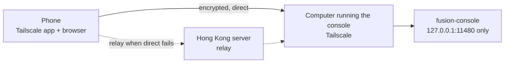

# Use fusion-console from your phone: quickstart

[中文](TAILSCALE_QUICKSTART_CN.md) · How it works, hardening and troubleshooting: [full guide](TAILSCALE.md)

When you finish, opening `https://your-computer.xxxx.ts.net` in your phone's browser gives you the console as if you were at the desk: chat, dispatch, workers and usage.

- **Only your own devices can reach it.** The computer and the phone sign in to the same Tailscale account, which puts them on a private network of their own. No public port is opened for the console.
- **HTTPS all the way.** Tailscale issues and renews the certificate.
- **About 40 minutes.** Every command can be pasted as is.



## Before you start

| | What | How |
|---|---|---|
| 1 | **A Tailscale account** | Sign in at <https://login.tailscale.com> with GitHub, Microsoft, Apple or Google — free. Every device below signs in to **this same account**. |
| 2 | **Tailscale on the phone** | **iPhone**: search "Tailscale" in the App Store. If the mainland-China store doesn't list it, use an Apple ID from another region (e.g. Hong Kong).<br>**Android**: install from Google Play, or without Play download the APK from the official package server <https://pkgs.tailscale.com/stable/#android>. Avoid other download sites. |
| 3 | **A small Hong Kong cloud server** (the relay) | Tencent Cloud Lighthouse or Alibaba Cloud ECS, region **Hong Kong**, the cheapest size (1 vCPU / 1 GB is plenty), image **Ubuntu 22.04** or newer. Note its **public IP**.<br>Only using home Wi-Fi, or not in mainland China? Skip it and step 4; connections may just be slower. |
| 4 | **The console opens locally** | On the computer running it, <http://127.0.0.1:11480> opens in a browser. Not installed yet? See the [start guide](../docs/START_GUIDE.md). |

## Step 1: Install Tailscale on the computer and sign in (5 min)

| OS | Install |
|---|---|
| macOS | Download <https://pkgs.tailscale.com/stable/Tailscale-latest-macos.pkg> (or the App Store), then menu bar icon → **Log in**. |
| Windows | Download <https://pkgs.tailscale.com/stable/tailscale-setup-latest.exe>, then tray icon → **Log in**. |
| Linux | `curl -fsSL https://tailscale.com/install.sh \| sh && sudo tailscale up`, then open the printed link. |

Use the account from item 1. The computer should now be listed at <https://login.tailscale.com/admin/machines>. **Note its name** (e.g. `office-mac`).

## Step 2: Turn on HTTPS (1 min)

On <https://login.tailscale.com/admin/dns>:

1. **MagicDNS**: make sure it's on (it usually is).
2. **HTTPS Certificates**: click **Enable**.

The page shows your tailnet name, like `tail1234.ts.net`. **Note it.**

## Step 3: Publish the console to your devices (2 min)

On the computer, open a terminal (Terminal on macOS, PowerShell on Windows):

```bash
# macOS: make the tailscale command available, then publish
alias tailscale=/Applications/Tailscale.app/Contents/MacOS/Tailscale
tailscale serve --bg 11480
```

```bash
# Windows (PowerShell)
tailscale serve --bg 11480

# Linux
sudo tailscale serve --bg 11480
```

Success looks like:

```
https://office-mac.tail1234.ts.net (tailnet only)
|-- / proxy http://127.0.0.1:11480
```

- `Serve is not enabled on your tailnet` plus a link: open the link, enable, run the command again.
- The setting persists across reboots; you only do this once.
- **Don't** use `tailscale serve --tcp` (no HTTPS — copy and voice input break) and **don't** use `tailscale funnel` (it publishes the console to the internet).

Check on the computer: open `https://computer-name.tailnet-name`, e.g. `https://office-mac.tail1234.ts.net`. **The first visit can take up to a minute** while the certificate is issued; refresh if it doesn't load yet.

> **Opens on the phone but not on this Mac?** The Mac has "Use Tailscale DNS" turned off. Run once (asks for your login password; replace `tail1234.ts.net` with yours). It only affects `ts.net` names:
>
> ```bash
> sudo sh -c 'mkdir -p /etc/resolver && echo "nameserver 100.100.100.100" > /etc/resolver/tail1234.ts.net'
> ```

## Step 4: Turn the Hong Kong server into your relay (15 min, recommended)

On mobile data the phone often can't reach the computer directly. Tailscale's shared relays are far from mainland China and busy, so this step makes your own server the relay. Traffic stays end-to-end encrypted.

**4.1 Open two ports** in the provider's firewall (Lighthouse: Firewall; ECS: Security group), source `0.0.0.0/0`: **TCP 8443** and **UDP 3478**.

**4.2 Log in** with the console's web terminal ("Login" button) — nothing to install.

**4.3 Run the setup script**, replacing `1.2.3.4` with the server's public IP:

```bash
curl -fsSLO https://raw.githubusercontent.com/dahai80/fusion-console/main/deploy/tailscale/setup-derp.sh
sudo bash setup-derp.sh 1.2.3.4
```

If it says `tailscale is installed but not logged in`, run

```bash
sudo tailscale up --hostname=derp-relay --accept-dns=false --accept-routes=false
```

approve the printed link with **the same account**, then run `sudo bash setup-derp.sh 1.2.3.4` again.

**4.4 Copy** the block the script prints, from `"derpMap": {` to its closing `}`.

**4.5 Paste it into the policy** at <https://login.tailscale.com/admin/acls> → **JSON editor**: put the cursor right after the first `{`, press Enter, paste, add a comma `,` after the pasted block's last `}`, then **Save**. Devices pick it up within a minute or two.

**Check**: `tailscale netcheck` on the computer lists `own` with a latency (e.g. `own: 35ms`).

## Step 5: Connect the phone (3 min)

1. Open the Tailscale app, sign in to **the same account**, switch it on, and allow the VPN configuration.
2. Open `https://computer-name.tailnet-name` in the phone's browser and log in to the console.
3. Add it to the home screen: iPhone Safari → Share → **Add to Home Screen**; Android Chrome → menu → **Add to Home screen**.

> iPhone allows one VPN at a time: turn other proxy apps off while using the console.

## Step 6: Three security must-dos

1. **Change the console's default password** — `fusion-admin-2026` is public. See [full guide, section 8](TAILSCALE.md).
2. **Require approval for new devices**: admin console → **Settings** → **Device management** → **Device approval**.
3. **Keep dispatch approval on**: console **Agents** → **大脑** (Brain) → before dispatching, keep **每次先问我** (ask me every time, the default).

Lost the phone? Remove it on the Machines page and it's out immediately.

## Common problems

| Problem | Fix |
|---|---|
| Phone can't open the address | Tailscale app shows Connected; computer is on and online in Tailscale; **Use Tailscale DNS** is on in the app settings. |
| Certificate error | HTTPS Certificates enabled (step 2); use `https://computer-name.tailnet-name`, not a `100.x.x.x` IP. |
| Doesn't load right after setup | The first certificate takes up to a minute; refresh. |
| Works but slow | Set up the relay (step 4); `tailscale ping phone-name` shows `direct` or `own`. |
| Copy button does nothing | You're on an `http://` address; use the `https://` one. |
| Clash / mihomo running on the computer | Exclude Tailscale from the proxy — [full guide](TAILSCALE.md). |
| Stop remote access | `tailscale serve reset` on the computer. |
