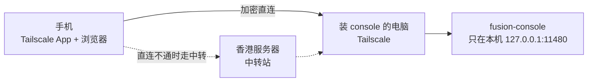

# 用手机控制 fusion-console：小白版指南

[English](TAILSCALE_QUICKSTART.md) · 原理、加固和排错细节见[详细版](TAILSCALE_CN.md)

做完这份指南，你在手机浏览器里打开 `https://你的电脑名.xxxx.ts.net`，就能像在电脑前一样用 console：聊天、派活、看 Worker 和用量。

- **只有你自己的设备能打开。** 电脑、手机都登录同一个 Tailscale 账号，相当于连上一张只属于你的私人网络。console 不对公网开放任何端口。
- **全程 HTTPS。** 地址带安全锁，证书由 Tailscale 自动签发、自动续期。
- **大约 40 分钟。** 需要输入命令的地方，命令都可以原样复制。



## 准备事项

开始前先把这四件事办好。

| | 准备什么 | 怎么办 |
|---|---|---|
| 1 | **Tailscale 账号** | 打开 <https://login.tailscale.com>，用 GitHub、Microsoft、Apple 或 Google 任一账号登录，免费。后面所有设备都登录**这同一个账号**。 |
| 2 | **手机装 Tailscale App** | **iPhone**：App Store 搜“Tailscale”。中国大陆区搜不到时，换外区（如香港）Apple ID 下载。<br>**Android**：有 Google Play 就在 Play 里装；没有的话从官方下载站 <https://pkgs.tailscale.com/stable/#android> 下载 APK 安装。不要从其他网站下载。 |
| 3 | **一台香港云服务器**（当中转站） | 腾讯云“轻量应用服务器”或阿里云 ECS 都行：地域选**中国香港**，配置选最便宜的一档（1 核 1 GB 就够），系统镜像选 **Ubuntu 22.04** 或更新版本。买好后记下**公网 IP**。<br>只在家里 Wi-Fi 用、或者人不在中国大陆，可以先不买，跳过第 4 步，连接可能慢一些。 |
| 4 | **电脑上的 console 能打开** | 在装 console 的那台电脑上，浏览器能打开 <http://127.0.0.1:11480>。还没装的先看[启动指南](../docs/START_GUIDE_CN.md)。 |

## 第 1 步：电脑装 Tailscale 并登录（5 分钟）

| 电脑系统 | 安装 |
|---|---|
| macOS | 下载 <https://pkgs.tailscale.com/stable/Tailscale-latest-macos.pkg> 双击安装（或 App Store 搜 Tailscale）。菜单栏出现 Tailscale 图标后点它 → **Log in**。 |
| Windows | 下载 <https://pkgs.tailscale.com/stable/tailscale-setup-latest.exe> 安装，右下角托盘图标 → **Log in**。 |
| Linux | 终端运行 `curl -fsSL https://tailscale.com/install.sh \| sh && sudo tailscale up`，打开它打印的链接登录。 |

用准备事项 1 的账号登录。登录后打开 <https://login.tailscale.com/admin/machines>，列表里能看到这台电脑就成功了。**记下它的名字**（比如 `office-mac`），后面的网址要用。

## 第 2 步：打开 HTTPS（1 分钟）

打开 Tailscale 后台的 DNS 页面 <https://login.tailscale.com/admin/dns>：

1. **MagicDNS**：确认是开启状态（多数账号默认已开）。
2. **HTTPS Certificates**：点 **Enable**。

这一页上方能看到你的网络名，形如 `tail1234.ts.net`，**记下来**。

## 第 3 步：把 console 发布给自己的设备（2 分钟）

在装 console 的电脑上打开终端（macOS 用“终端”，Windows 用“PowerShell”），粘贴对应的命令：

```bash
# macOS：先让 tailscale 命令能直接用，再发布
alias tailscale=/Applications/Tailscale.app/Contents/MacOS/Tailscale
tailscale serve --bg 11480
```

```bash
# Windows（PowerShell）
tailscale serve --bg 11480

# Linux
sudo tailscale serve --bg 11480
```

看到类似下面的输出就成功了：

```
https://office-mac.tail1234.ts.net (tailnet only)
|-- / proxy http://127.0.0.1:11480
```

- 如果提示 `Serve is not enabled on your tailnet` 并给出一个链接：打开链接点启用，再运行一次命令。
- 这个设置会一直保存，电脑重启后自动恢复，只需要做一次。
- **不要**用 `tailscale serve --tcp`：它不走 HTTPS，复制、语音等功能会失效。**不要**用 `tailscale funnel`：它会把 console 公开到互联网上。

先在这台电脑上验证：浏览器打开 `https://电脑名.网络名`，例如 `https://office-mac.tail1234.ts.net`。**第一次打开要等半分钟到一分钟**，这期间在签发证书，打不开就稍等再刷新。

> **Mac 上打不开、手机上能打开？** 说明这台 Mac 关了“使用 Tailscale DNS”。在终端运行一次下面的命令（会要求输入开机密码，把 `tail1234.ts.net` 换成你自己的网络名）。它只影响 `ts.net` 网址，不影响其他上网：
>
> ```bash
> sudo sh -c 'mkdir -p /etc/resolver && echo "nameserver 100.100.100.100" > /etc/resolver/tail1234.ts.net'
> ```

## 第 4 步：在香港服务器上搭中转站（15 分钟，推荐）

手机在 4G/5G 下经常没法和电脑直接连上，这时就要绕道。Tailscale 自带的中转站离中国大陆远，又是很多人共用，会慢。这一步把你自己的香港服务器变成专用中转站。数据一直是加密的，中转站看不到内容。

**4.1 放行两个端口。** 在云控制台找到这台服务器：腾讯云轻量在“防火墙”，阿里云 ECS 在“安全组”。添加两条入站规则，来源都填 `0.0.0.0/0`：

| 协议 | 端口 |
|---|---|
| TCP | 8443 |
| UDP | 3478 |

**4.2 登录服务器。** 在控制台点这台服务器的“登录”按钮，会打开网页终端，不需要另外装软件。

**4.3 运行安装脚本。** 把 `1.2.3.4` 换成你服务器的公网 IP：

```bash
curl -fsSLO https://raw.githubusercontent.com/dahai80/fusion-console/main/deploy/tailscale/setup-derp.sh
sudo bash setup-derp.sh 1.2.3.4
```

第一次要几分钟。如果脚本提示 `tailscale is installed but not logged in`，先运行：

```bash
sudo tailscale up --hostname=derp-relay --accept-dns=false --accept-routes=false
```

打开它打印的链接，用**同一个账号**批准，然后再运行一次 `sudo bash setup-derp.sh 1.2.3.4`。

**4.4 复制配置。** 脚本最后会打印一段以 `"derpMap": {` 开头的内容，从这一行复制到它对应的最后一个 `}`。

**4.5 粘贴到 Tailscale 后台。** 打开 <https://login.tailscale.com/admin/acls>，切到 **JSON editor**：

1. 把光标放在第一行 `{` 的后面，回车换一行。
2. 粘贴刚才复制的内容。
3. 在粘贴内容的最后一个 `}` 后面加一个英文逗号 `,`。
4. 点 **Save**。

一两分钟后，所有设备都会用上这个中转站。

**检查**：在电脑终端运行 `tailscale netcheck`。输出里 `own` 后面有毫秒数（比如 `own: 35ms`），就说明中转站工作正常。

## 第 5 步：手机连上（3 分钟）

1. 打开手机上的 Tailscale App，登录**同一个账号**，把开关打开。第一次会请求“添加 VPN 配置”，点允许。
2. 用手机浏览器打开 `https://电脑名.网络名`（和第 3 步一样的网址），用 console 的账号密码登录。
3. 把它放到主屏幕，以后像 App 一样点开：
   - iPhone Safari：分享按钮 → **添加到主屏幕**。
   - Android Chrome：右上角菜单 → **添加到主屏幕**。

> iPhone 同一时间只能开一个 VPN。用 console 时打开 Tailscale，其他代理类 App 先关掉。

## 第 6 步：三件安全的事（必做）

1. **改掉 console 的默认密码。** 出厂密码 `fusion-admin-2026` 写在公开文档里，必须改。方法见[详细版第 8 节](TAILSCALE_CN.md#8-安全加固必做)。
2. **新设备要你批准。** Tailscale 后台 → **Settings** → **Device management** → 打开 **Device approval**。
3. **派活前先问你。** console 里 **Agents** → **大脑** → “派活之前”保持 **每次先问我**（默认就是）。

手机丢了：Tailscale 后台 Machines 页找到它 → **Remove**，它立刻就进不来了。

## 常见问题

| 遇到的情况 | 怎么办 |
|---|---|
| 手机打不开网址 | Tailscale App 是否显示 Connected；电脑是否开机、Tailscale 是否在线；App 设置里 **Use Tailscale DNS** 是否打开。 |
| 提示证书错误 | 第 2 步的 HTTPS Certificates 是否已开启；网址要用 `https://电脑名.网络名`，不要用 `100.x.x.x` 这种 IP。 |
| 刚设置完打不开 | 第一次要等签发证书，等一分钟再刷新。 |
| 能打开但很慢 | 做第 4 步的中转站；电脑终端运行 `tailscale ping 手机名`，看显示的是 `direct`（直连）还是 `own`（走自己的中转站）。 |
| 复制按钮没反应 | 用的是 `http://` 地址，换成 `https://` 的网址。 |
| 电脑开着 Clash、mihomo 等代理 | 按[详细版第 9 节](TAILSCALE_CN.md#9-和-clash--mihomo-等本机代理共存)把 Tailscale 排除出代理。 |
| 不想再远程访问 | 电脑终端运行 `tailscale serve reset`。 |
